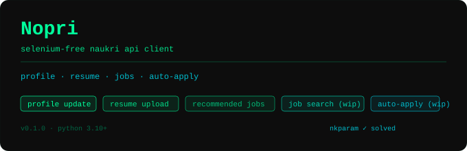

<p align="center">
  
</p>

# Noperi

A lightweight, Selenium-free Python API client for Naukri.com — plus a fully autonomous Telegram bot that updates your profile daily, pings you with recommended jobs every evening, and lets you search and apply without opening a browser.

---

**Status:** 🟢 Working (Last tested: May 2026)

---

## ✨ Features

| Feature | Status |
|---|---|
| Login & session management (Bearer token) | ✅ Working |
| Resume upload (PDF) | ✅ Working |
| Profile update (headline, name, summary) | ✅ Working |
| Recommended jobs feed | ✅ Working |
| Job search with filters (keyword, location, exp, company, dept) | ✅ Working |
| One-click job apply (easy apply) | ✅ Working |
| Apply with questionnaire answers | ✅ Working |
| `nkparam` token generator (pure API, no Selenium) | ✅ Working |
| `nkparam` token harvester (Selenium fallback) | ✅ Working |
| Telegram bot — autonomous daily profile rotation | ✅ Working |
| Telegram bot — evening recommended jobs feed | ✅ Working |
| Telegram bot — inline search + one-tap apply | ✅ Working |
| OTP login / MFA | 🚧 Under development |

---

## 🗂️ Project Structure

```
NopeRi/
├── main.py                        # Entry point — demo of all API features
├── bot.py                         # Telegram bot (autonomous + interactive)
├── updateDaily.py                 # Standalone daily profile updater (no bot)
├── .env                           # Credentials & config
├── scheduler_state.json           # Bot rotation state (auto-created, gitignored)
├── assets/
│   └── resume.pdf                 # Default resume used by the bot
└── src/
    ├── client/
    │   ├── naukri_client.py       # Auth + profile + resume client
    │   ├── job_client.py          # Recommended jobs + search + apply
    │   ├── jop_classifier.py      # Job relevance classifier
    │   └── session.py             # requests.Session factory
    ├── config/
    │   ├── constants.py           # URLs, regex patterns, app IDs
    │   └── content.py             # Static pool of headlines & summaries for rotation
    ├── exceptions/
    │   └── exceptions.py          # Custom exception classes
    ├── models/
    │   └── models.py              # Dataclasses: Job, NaukriSession, etc.
    └── utils/
        ├── extractors.py          # HTML / JS parsing helpers
        ├── request_helper.py      # Exponential-retry decorator
        ├── get_Nkparam.py         # Selenium helper to harvest nkparam tokens
        ├── nkparam_generator.py   # Pure-API nkparam generator
        └── dbhandler.py           # DB utilities
```

---

## 🤖 Telegram Bot

`bot.py` is an autonomous Telegram bot that manages your Naukri presence hands-free.

### Scheduled jobs (automatic, no interaction needed)

| Time (IST) | What it does |
|---|---|
| **08:30 + random 0–3 h** | Rotates your Naukri profile: cycles H→H→S (Headline, Headline, Summary) and refreshes the resume every 4th update |
| **22:00** | Fetches up to 15 personalised recommended jobs and sends each as a separate Telegram message with **Apply** and **View Job** buttons |

### Commands

| Command | Description |
|---|---|
| `/ping` | Open the manual profile-update menu — choose to update headline, summary, or resume interactively |
| `/testrun` | Force-run the morning profile update immediately (skips random delay and the "already ran today" guard — useful for testing) |
| `/jobnow` | Force-fetch the recommended jobs feed right now instead of waiting for 22:00 |
| `/search <keyword> [exp=N] [loc=City] [company=Name] [page=N]` | Search Naukri for jobs with optional filters; results are sent as individual messages with Apply + View Job buttons |
| `/cancel` | Cancel any in-progress interactive flow (manual update or questionnaire) |

**`/search` examples:**
```
/search Java backend
/search Spring Boot exp=2 loc=Hyderabad
/search Kafka company=Zepto exp=3 page=2
```

### Apply flow

Each job message has two inline buttons:

- **✅ Apply** — triggers the apply flow:
  - **Direct / easy apply** → applied instantly, confirmation sent
  - **External apply** → the Naukri redirect link is sent so you can complete it on-site
  - **Questionnaire required** → the bot presents each question inline (radio buttons or free text); after your last answer it submits the full application automatically
- **🔗 View Job** → opens the Naukri job listing in your browser

### Bot setup

Add to `.env`:

```env
TELEGRAM_BOT_TOKEN=<token from @BotFather>
TELEGRAM_CHAT_ID=<your numeric chat ID>
USERNAME=your_naukri_email@example.com
PASSWORD=your_naukri_password
DEFAULT_RESUME_PATH=assets/resume.pdf   # optional
TIMEZONE=Asia/Kolkata                   # optional
NAUKRI_DEFAULT_FAREA=                   # optional — farea ID for a default department filter on /search
```

Populate `src/config/content.py` with your headline and summary rotation pools:

```python
HEADLINES: list[str] = [
    "Backend Engineer | Java · Spring Boot · Kafka",
    # ... up to 20 entries
]
SUMMARIES: list[str] = [
    "2+ years building distributed systems ...",
    # ... up to 10 entries
]
```

Run locally:
```bash
python bot.py
```

Run on a server (systemd):
```bash
sudo systemctl start noperi-bot
sudo systemctl enable noperi-bot
journalctl -u noperi-bot -f
```

---

## ⚙️ Installation

**Requirements:** Python 3.10+

```bash
git clone https://github.com/Traverser25/NopeRi.git
cd NopeRi
pip install -r requirements.txt
```

Create a `.env` file in the project root:

```env
USERNAME=your_naukri_email@example.com
PASSWORD=your_naukri_password
```

---

## 🚀 Quick Start (API only)

You can run `main.py` directly, or use the client programmatically:

```python
from src.client.naukri_client import NaukriLoginClient
from src.client.job_client import NaukriJobClient
from dotenv import load_dotenv
import os, time

load_dotenv()

# 1. Login
client = NaukriLoginClient(os.getenv("USERNAME"), os.getenv("PASSWORD"))
client.login()

# 2. Upload resume
client.update_resume("path/to/your_resume.pdf")

# 3. Update profile headline / summary
client.update_profile(headline="Backend Engineer | Java · Spring Boot · Kafka")
client.update_profile(summary="Experienced engineer with 2+ years building scalable APIs.")

# 4. Job client
jc = NaukriJobClient(client)

# 5. Recommended jobs
for job in jc.get_recommended_jobs():
    print(job.title, "—", job.company)

# 6. Search jobs
jobs = jc.search_jobs(
    keyword="Java backend",
    location="Hyderabad",
    experience=2,
    company="",          # optional company filter
    farea="",            # optional department filter
)

# 7. Apply (easy apply — skips questionnaire jobs)
for job in jobs:
    result = jc.apply_job(job, source="search")
    job_result = (result.get("jobs") or [{}])[0]
    if job_result.get("questionnaire"):
        print("Skipped (questionnaire):", job.title)
        continue
    print("Applied:", job.title)
    time.sleep(2)

# 8. Apply with questionnaire answers
answers = {"q_id_1": "ans_key_1", "q_id_2": "My text answer"}
jc.apply_with_answers(job, answers, source="search")
```

---

## 📖 API Reference

### `NaukriLoginClient`

| Method | Description |
|---|---|
| `login()` | Authenticates and stores the Bearer token + session cookies |
| `update_resume(file)` | Uploads a PDF resume; accepts a file path (`str`) or file-like object |
| `update_profile(headline, name, summary)` | Updates one or more profile fields (all args optional) |
| `fetch_profile_id()` | Returns your Naukri profile ID (cached after first call) |
| `get_form_key2()` | Extracts the internal `formKey` from Naukri's JS bundle (cached) |

### `NaukriJobClient`

| Method | Signature | Description |
|---|---|---|
| `get_recommended_jobs()` | `() → list[Job]` | Returns personalised recommended jobs |
| `search_jobs()` | `(keyword, location, page, experience, results_per_page, company, farea) → list[Job]` | Full-text job search with optional filters |
| `apply_job()` | `(job, mandatory_skills, optional_skills, sid, source) → dict` | Applies to a job; returns raw API response including questionnaire if present |
| `apply_with_answers()` | `(job, answers: dict, sid, source) → dict` | Submits a questionnaire-gated application with pre-built answers `{questionId: answerKey}` |
| `get_job_details()` | `(job_id, sid) → dict` | Fetches full job details |

### `Job` model

```python
@dataclass
class Job:
    job_id:      str
    title:       str
    company:     str
    location:    str
    experience:  str
    salary:      str
    posted_date: str
    apply_link:  str
    description: str = ""
    tags:        list[str] = field(default_factory=list)
    logo_url:    str = ""   # https://img.naukimg.com/logo_images/groups/v1/{companyId}.gif
```

---

## 🔑 The `nkparam` Problem (and Current Solution)

Naukri's job-search endpoint (`/jobapi/v3/search`) requires a `nkparam` request header — an encrypted/signature key generated from the current timestamp and session context. Without it the API returns `403 Forbidden`.

**Current solution:** `nkparam` is generated directly via API logic in `src/utils/nkparam_generator.py` — no browser or Selenium required.

**Fallback:** `src/utils/get_Nkparam.py` — a Selenium script that opens Chrome, captures network requests, extracts valid tokens, and stores them in `nkPool.txt`.

```bash
python src/utils/get_Nkparam.py   # optional fallback, Ctrl+C to stop
```

---

## ⚠️ IP & Hosting Advice

Naukri fingerprints IPs. Many cloud providers trigger MFA or get blocked.

**Avoid:** Azure, GitHub Actions/CI, some GCP regions, datacenter IP ranges  
**Works:** AWS EC2 with Elastic IP, Oracle OCI (tested), home broadband, mobile hotspot, residential proxy

> Sessions are IP-bound — changing IP will invalidate your login.

---

## ⚠️ Disclaimer

This project is for personal automation of **your own** Naukri account. Use responsibly and in accordance with [Naukri's Terms of Service](https://www.naukri.com/termsAndConditions). Not affiliated with Naukri / InfoEdge India Ltd.

---

## 🛣️ Roadmap

- [x] Job search endpoint integration
- [x] One-click job apply
- [x] Apply with questionnaire answers
- [x] Telegram bot with autonomous daily profile rotation
- [x] Evening recommended jobs feed via Telegram
- [x] Inline job search + apply from Telegram
- [ ] OTP / MFA login
- [ ] Async support (`httpx` / `aiohttp`)
- [ ] CLI interface

---

## 🤝 Contributing

Pull requests are welcome! The main open piece is OTP/MFA login automation — if you can help, open an issue or PR.

